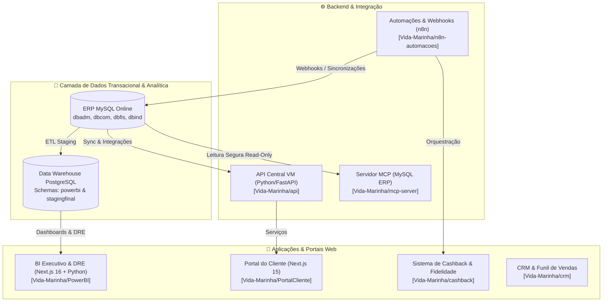

# 🌊 Vida Marinha — Ecossistema de Tecnologia & Gestão

Bem-vindo ao hub central de tecnologia da **Vida Marinha**. Esta organização reúne todos os repositórios, serviços, microsserviços e integrações que sustentam a operação comercial, contábil, industrial e analítica da empresa.

---

## 🏛️ Mapa de Arquitetura do Ecossistema

---

## 📦 Repositórios por Domínio de Negócio

### 1. 📊 Inteligência de Negócios & Controladoria
- **[PowerBI](https://github.com/Vida-Marinha/PowerBI)**
  - **Função:** Plataforma unificada de Business Intelligence, Controladoria Financeira (DRE) e Dashboard Executivo.
  - **Stack:** Next.js 16 (React 19), Python (DRE Multithread), PostgreSQL DW, Tailwind CSS v4.
  - **Produção:** `bi-vidamarinha.alvo7app.com`

---

### 2. 🛍️ Relacionamento com Clientes & Vendas
- **[PortalCliente](https://github.com/Vida-Marinha/PortalCliente)**
  - **Função:** Portal B2B oficial para clientes e representantes acompanharem pedidos, faturamento e notas fiscais.
  - **Stack:** Next.js 15, Tailwind CSS, PostgreSQL & MySQL, CI/CD GitHub Actions.
- **[cashback](https://github.com/Vida-Marinha/cashback)**
  - **Função:** Plataforma de cashback e fidelidade para clientes finais e lojistas com integrações via WhatsApp.
  - **Stack:** Node.js (Express), Prisma ORM, React SPA, PostgreSQL.
- **[crm](https://github.com/Vida-Marinha/crm)**
  - **Função:** Gestão de pipeline comercial, acompanhamento de funis de prospecção e oportunidades de vendas.
  - **Stack:** Python (FastAPI/Flask), Interface Web, PostgreSQL.

---

### 3. 🔌 Serviços, Backend & Inteligência Artificial
- **[api](https://github.com/Vida-Marinha/api)**
  - **Função:** API central de backend para consulta de pedidos, regras de negócio e integração de dados do ERP.
  - **Stack:** Python, Flask/FastAPI, Gunicorn.
- **[mcp-server](https://github.com/Vida-Marinha/mcp-server)**
  - **Função:** Servidor Model Context Protocol (MCP) para conexões analíticas e seguras ao banco MySQL ERP Online via agentes de IA.
  - **Stack:** Python, MCP SDK, MySQL (modo Read-Only estrito).
- **[n8n-automacoes](https://github.com/Vida-Marinha/n8n-automacoes)**
  - **Função:** Repositório de fluxos automatizados, webhooks de mensageria, scripts de apoio e sincronizações agendadas.
  - **Stack:** n8n, Python, Bash, SQL.

---

## 🚀 Padrões de Desenvolvimento & Deploy

- **Branches:** A branch principal oficial é `main`. Features e correções seguem o formato `feat/<slug>` ou `fix/<slug>`.
- **Commits:** Padronização com [Conventional Commits](https://www.conventionalcommits.org/) (`feat:`, `fix:`, `refactor:`, `chore:`).
- **Segurança:** Nenhuma credencial ou arquivo `.env` deve ser commitado nos repositórios.
